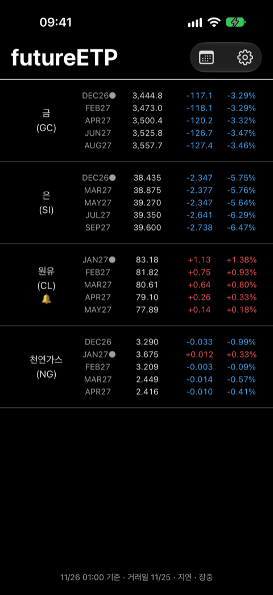
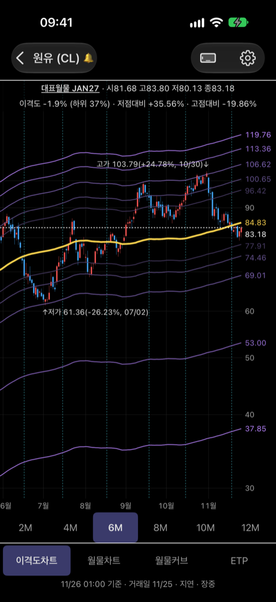
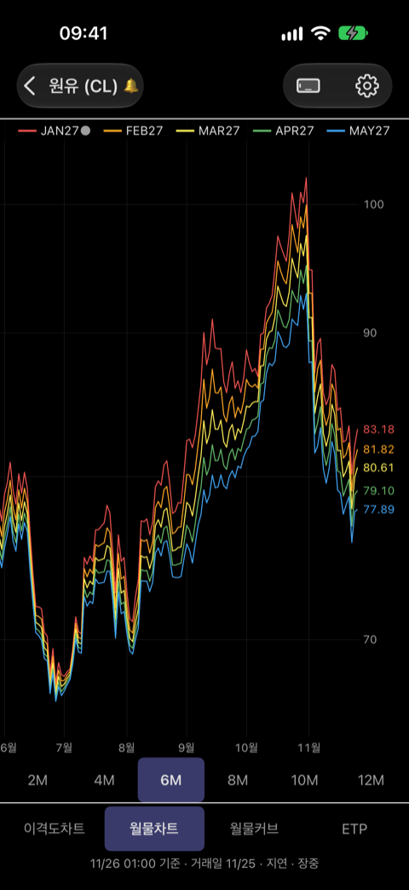
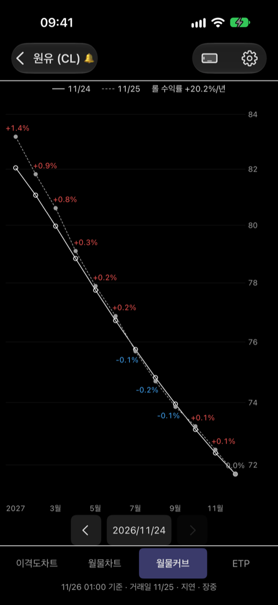
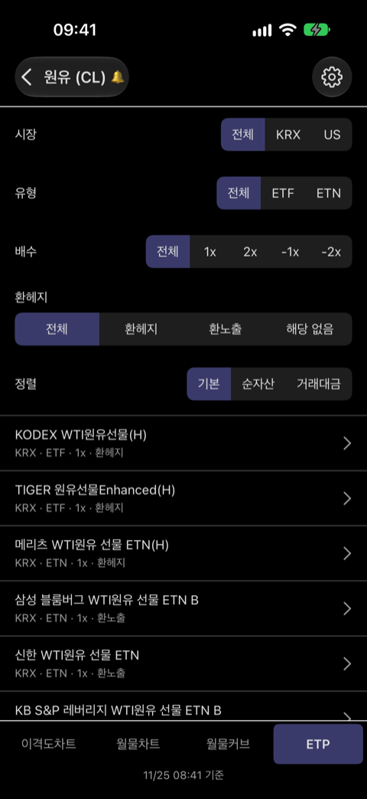
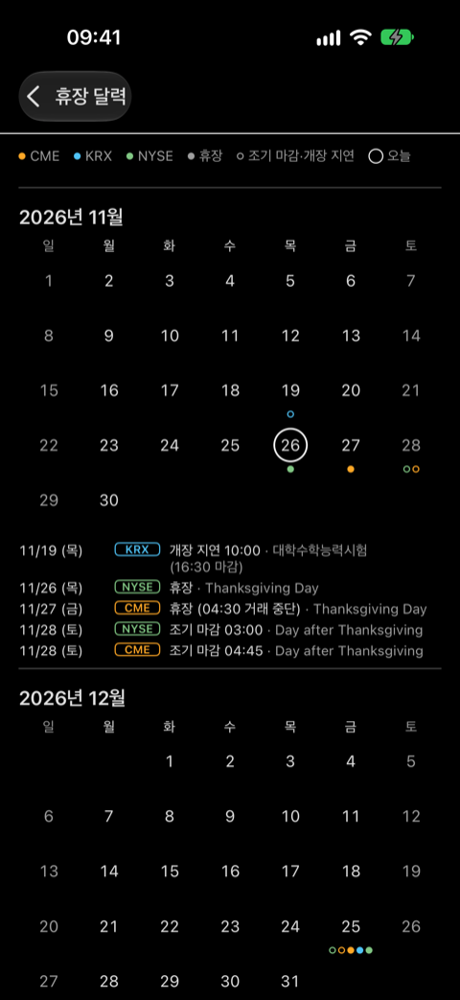
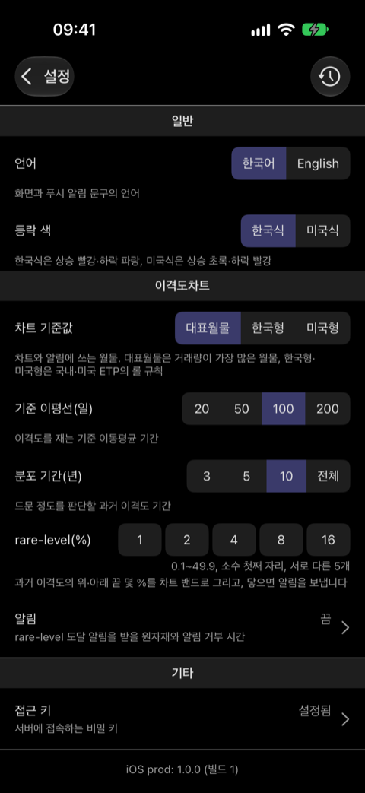
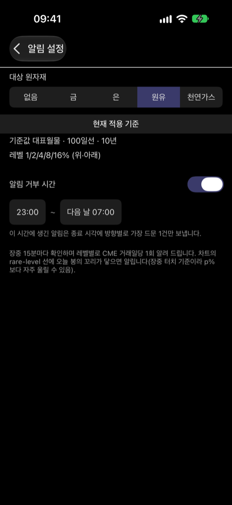
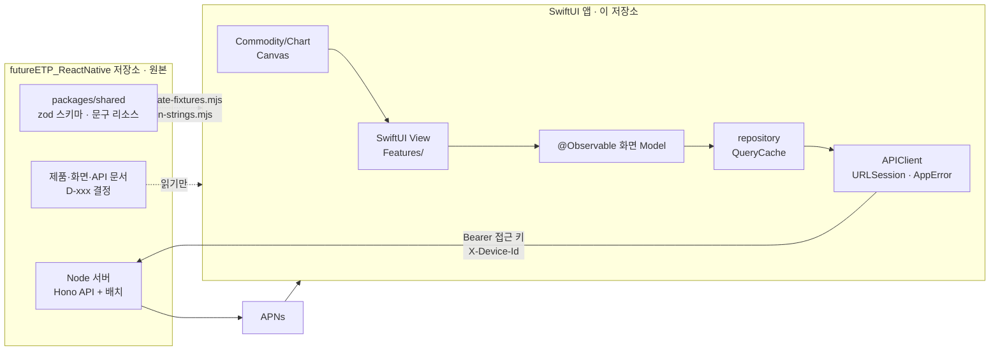
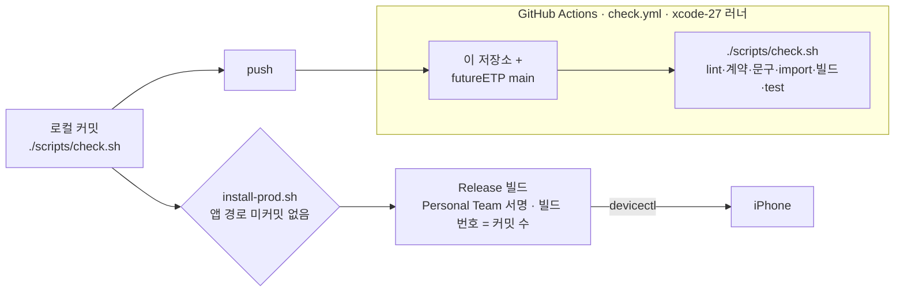

# futureETP (iOS)

원자재 선물 기반 ETP(ETF/ETN)에 투자할 때 필요한데 기존 시세 서비스에는 없는 정보를 보여 주는 개인용 모바일 앱 futureETP의 Swift/SwiftUI 클라이언트입니다.
iOS 전용, 사용자 본인 1명용(스토어 미배포)이고, React Native 원본 앱([futureETP_ReactNative](https://github.com/seyoun10/futureETP_ReactNative))과 기능·화면·동작을 똑같이 맞춰 만들었습니다.

<table>
  <tr>
    <th>원자재 목록</th>
    <th>이격도차트</th>
    <th>월물차트</th>
    <th>월물커브</th>
  </tr>
  <tr>
    <td></td>
    <td></td>
    <td></td>
    <td></td>
  </tr>
  <tr>
    <th>ETP 목록</th>
    <th>휴장 달력</th>
    <th>설정</th>
    <th>알림 설정</th>
  </tr>
  <tr>
    <td></td>
    <td></td>
    <td></td>
    <td></td>
  </tr>
</table>

iOS 시뮬레이터(iPhone 18 Pro)에서 prod 서버에 붙어 찍은 화면입니다. 같은 화면의 RN 앱 모습은 원본 저장소의 [README](https://github.com/seyoun10/futureETP_ReactNative#readme)에 있습니다.

## 왜 만들었나

원유·천연가스·금·은 ETP는 실물이 아니라 선물을 보유하고, 상품마다 정해진 규칙으로 월물을 롤오버합니다.
그런데 인베스팅·트레이딩뷰 같은 서비스는 자기 기준의 "대표 월물" 시세만 보여 줍니다.
그래서 내가 산 ETP가 실제로 따라가는 가격 흐름, 롤오버 비용, 지금 가격이 역사적으로 얼마나 드문 구간인지 알기 어렵습니다.

같은 서버·API 계약 위에 RN·Flutter·SwiftUI·Kotlin 앱을 각각 만들어, 플랫폼마다 같은 제품을 어떻게 구현하는지 비교합니다. 이 저장소는 그중 네이티브 iOS(SwiftUI) 구현입니다.

## 주요 기능

- **이격도차트**: ETP 롤 규칙으로 월물을 혼합한 수익률 연결 지수를 봉차트로 그리고 롤 구간을 표시합니다. 이동평균선, rare 레벨 밴드, 고점·저점 대비 등락을 함께 보여 주고, 가장 과거 봉이 보이면 이전 3년을 이어 받습니다.
- **월물커브**: 기준일과 그다음 거래일의 커브를 겹쳐 월물별 변화율, 콘탱고/백워데이션, 연 환산 롤 수익률을 보여 줍니다(OS 날짜 피커로 2010년 이후 아무 날이나 기준일로 선택).
- **월물차트·ETP 목록**: 월물별 가격 비교와 양끝 월물의 연 환산 롤 수익률, 해당 원자재를 추종하는 국내(KRX)·미국 ETP의 롤 규칙·배수·보수·거래대금을 보여 줍니다.
- **휴장 달력**: CME·KRX·NYSE의 휴장·조기 마감·개장 지연 일정을 3개월간 한 달력에 시장별 색 점으로 보여 주고, 시각은 기기 시간대로 바꿔 표시합니다.
- **알림**: 가격이 rare 레벨에 도달하면 APNs 푸시로 받습니다. Apple Developer 가입 전이라 기기 토큰 등록은 남아 있고, 알림 설정 화면과 권한 배너는 동작합니다([TODO](TODO.md)).
- **접근 키**: QR 스캔(VisionKit) 또는 붙여넣기로 접근 키를 넣어 Keychain에 저장하고, 키가 거절되면 어느 화면에서든 접근 키 화면으로 보냅니다.
- 한국어·영어 UI, 다크 테마, 가로 모드 차트, 핀치 줌·드래그·십자선 제스처와 햅틱, 제스처 동안 120Hz(ProMotion) 그리기를 지원합니다.

대상 원자재는 금(GC)·은(SI)·WTI 원유(CL)·천연가스(NG)입니다.

## 아키텍처



- **서버를 만들지 않음**: 원본 저장소의 서버(prod VM, dev는 로컬)를 RN 앱과 함께 씁니다. 지수·롤 비중·이격도 같은 계산은 모두 서버가 하고, 앱은 서버 값을 표시만 합니다(포맷·반올림 표시는 예외).
- **원본 문서를 읽기만**: 제품 기획·화면 와이어프레임·API 규약·공통 결정(D-xxx)은 원본 저장소에만 두고 상대 경로(`../futureETP_ReactNative`)로 읽습니다. 이 저장소는 SwiftUI 구현과 그 결정(IOS-xxx)만 갖습니다. 원본이 바뀌면 [`TODO.md`](TODO.md)의 "원본 변경 반영" 절과 "마지막 대조" 커밋 이후 RN 커밋으로 따라잡습니다.
- **레이어(MVVM + repository)**: SwiftUI View → `@Observable` 화면 Model → repository(조회 캐시·무한 조회·낙관적 PATCH) → `APIClient`(헤더·타임아웃·봉투 디코딩·재시도) 한 방향으로만 호출합니다. UseCase·Entity 계층은 두지 않습니다(IOS-005). RN TanStack Query의 staleTime·gcTime·자동 새로고침은 `QueryCache`로 직접 만들었습니다.
- **모듈로 import 방향 강제**: Tuist로 App → features(framework 타깃 4개) → Core 의존성만 선언하고, 선언 밖 import와 쓰지 않는 선언을 `tuist inspect dependencies`가 실패로 잡습니다. feature끼리, Core에서 위로는 import할 수 없습니다(IOS-003).
- **API 계약**: 응답 모델은 손으로 쓴 `Codable`이고, 저장한 dev 서버 응답을 같은 파일로 두 번 검사합니다. 원본 zod 스키마로 통과하는지(Node), `APIClient`로 디코딩되는지(Swift Testing)입니다. JSON Schema가 zod에서 생성되므로 zod로 보면 refine 규칙까지 함께 봅니다(IOS-007).
- **차트**: Swift Charts는 봉 756개에서 23fps에 그쳐, SwiftUI `Canvas`에 색별 `Path`로 봉·선·밴드·축·십자선을 직접 그립니다(같은 조건 60fps, IOS-008). 제스처는 UIKit 인식기로 받고, 제스처 동안 `CADisplayLink`로 120Hz를 요청합니다.
- **문구**: String Catalog를 RN 문구 리소스(`locales/ko.ts`·`en.ts`)에서 스크립트로 생성해 두 앱의 키·문구가 어긋나지 않게 합니다. iOS 전용 문구만 따로 둡니다(IOS-009).
- **변형**: Tuist configuration `Debug-Dev`·`Release`(scheme `FutureETP-Dev`·`FutureETP`) + xcconfig. 앱 ID는 RN과 같은 `io.github.seyoon.futureetp`(dev `.dev`)라 한 기기에 RN 앱과 함께 설치할 수 없고, 서버에는 `appVersion`을 `ios-<버전>`으로 보내 구분합니다(IOS-002).

## 기술 스택

| 영역 | 사용 기술 |
|---|---|
| 공통 | Swift 6 (strict concurrency), Xcode 27.2, 최소 배포 iOS 18 |
| UI·상태·내비게이션 | SwiftUI, Observation(`@Observable`), `NavigationStack` + `TabView`(C 하단 탭) |
| 네트워크·모델 | `URLSession` async/await + `Codable` |
| 차트 | SwiftUI `Canvas` 직접 구현, UIKit 제스처 인식기, `CADisplayLink` 프레임 속도 요청 |
| 저장 | Keychain(`Security`, 접근 키·installation ID), `UserDefaults`(언어·등락 색) |
| 기타 | VisionKit `DataScannerViewController`(QR), `sensoryFeedback`(햅틱), String Catalog(i18n), SF Symbols, APNs(`UNUserNotificationCenter`) |
| 외부 패키지 | 없음 |
| 프로젝트 | Tuist 4(`Project.swift`, 버전은 `mise.toml`에 고정, 생성물은 커밋 안 함) |
| Test/Lint | Swift Testing, swift-format(Xcode 동봉), `tuist inspect dependencies`, Node 스크립트(계약 예시·문구 카탈로그) |

버전과 선택 근거, RN 스택 대응은 [`docs/tech-stack.md`](docs/tech-stack.md)에 있습니다.

## 개발 방식

- 스택 후보와 구조를 문서로 먼저 정하고, 차트는 Canvas와 Swift Charts를 같은 조건으로 재는 스파이크로 정한 뒤, RN 화면 순서대로 수직 슬라이스(화면 → 화면 Model → repository → API)로 구현했습니다.
- RN·Expo 전용인 공통 결정은 iOS 수단으로 바꿔 적용하고, 그 방식을 결정 10건으로 근거·대안과 함께 [`docs/decisions.md`](docs/decisions.md)(IOS-001~)에 기록했습니다.
- 화면을 다 만든 뒤 원본 [`screens.md`](https://github.com/seyoun10/futureETP_ReactNative/blob/main/docs/wireframes/screens.md)의 화면별 동작과 RN 문구를 하나씩 대조했고, 실기기(iPhone 14 Pro)에서 Instruments(Animation Hitches·Time Profiler)로 차트 제스처 성능을 재며 고쳤습니다.
- 커밋 전 `./scripts/check.sh`(lint·계약 예시·문구 카탈로그·import 방향·Swift 6 언어 모드·Release 빌드·전체 테스트)를 통과해야 하고, push마다 CI가 같은 검사를 다시 돌립니다.

| 문서 | 내용 |
|---|---|
| [`docs/tech-stack.md`](docs/tech-stack.md) | 기술 스택과 버전, RN 스택 대응, SF Symbols 대응 |
| [`docs/architecture.md`](docs/architecture.md) | 디렉터리 구조, 레이어, RN 구조 대응, D-번호 적용표 |
| [`docs/decisions.md`](docs/decisions.md) | 이 저장소 결정 IOS-xxx |
| [`docs/ops.md`](docs/ops.md) | 기기 설치·업데이트, RN·Flutter 앱과 바꿔 설치 |
| [`docs/history.md`](docs/history.md) | 끝난 단계 기록(실기기 확인·성능 측정 포함) |
| [`TODO.md`](TODO.md) | 남은 항목, 원본 변경 반영 |

## 품질 검증과 테스트

테스트는 Swift Testing `@Test` 382개(테스트 타깃 5개)입니다. RN과 "똑같이" 동작하는지를 사람 눈이 아니라 테스트와 스크립트로 확인하는 데 무게를 둡니다.

| 계층 | 방법 | 기대 효과 |
|---|---|---|
| API 계약 | dev 서버 응답·요청 본문 예시(`Core/Tests/Fixtures`)를 원본 zod 스키마로 검증(`scripts/validate-fixtures.mjs`)하고, 같은 파일을 `APIClient`로 디코딩·요청 모델로 인코딩(`ContractFixtureTests`·`RequestEncodingTests`) | 서버·계약 변경이 앱을 조용히 깨뜨리지 않고, 모델의 필드·nullable·enum 누락을 찾습니다 |
| RN과 같은 결과 | 숫자·날짜 표기, 차트 눈금·라벨 배치·꼬리표, 커브 라벨 배치, 조회 캐시 규칙을 RN 테스트와 같은 기대값으로 고정(JS `toFixed` 반올림은 node로 확인) | `2,405.1`·`+0.51%`·`DEC26` 같은 표기와 축 눈금이 두 앱에서 한 글자도 다르지 않게 유지됩니다 |
| 문구 | String Catalog가 RN 문구 리소스로 만든 결과와 같은지, Swift 코드가 쓰는 키가 모두 있는지 검사(`scripts/gen-strings.mjs --check`) | RN 문구가 바뀌었는데 iOS만 옛 문구로 남거나 없는 키로 빈 글자가 보이지 않습니다 |
| API client·조회 | 가짜 HTTP로 인증 헤더·봉투 디코딩·`AppError` 변환(`NETWORK`·`TIMEOUT`·`SCHEMA_MISMATCH`)·재시도, `QueryCache`의 staleTime·진행 중 조회 합류·무효화를 테스트 | 에러 처리 규약(D-072)과 캐시 동작이 화면마다 다르게 새지 않습니다 |
| 화면 Model·차트 | 화면 Model·차트 뷰포트(핀치·이동)·십자선 상호작용·과거 봉 붙이기 범위 유지·설정 저장 순서를 순수 로직으로 테스트 | 제스처·십자선·설정 저장처럼 기기에서만 드러나던 상태 버그의 회귀를 막습니다 |
| 정적 검사 | Swift 6 언어 모드(strict concurrency)를 모든 타깃·configuration에서 확인, swift-format `--strict`, Tuist 모듈 import 방향(implicit·redundant) | 데이터 경쟁·의존 방향 위반·포맷 어긋남을 실행 전에 막습니다 |

손동작·햅틱·120Hz·QR·권한 배너처럼 테스트로 보기 어려운 부분은 실기기(iPhone 14 Pro)에서 확인하고 [`docs/history.md`](docs/history.md)에 남깁니다.

## CI/CD

배포는 자동으로 하지 않습니다. 사용자 1명인 개인용 앱이라 스토어·TestFlight·OTA 없이 Mac에서 iPhone으로 직접 설치합니다.



### CI (GitHub Actions)

| job | 언제 | 무엇을 | 기대 효과 |
|---|---|---|---|
| `check` | main push·PR·수동 | 로컬과 같은 Xcode 27.2·Tuist 버전으로, 원본 저장소 main을 함께 받아 `./scripts/check.sh` 실행 | 로컬 환경 차이나 검사를 건너뛴 커밋도 같은 기준으로 걸러지고, 원본 계약·문구가 바뀌면 여기서 먼저 실패해 따라잡을 때를 압니다 |

### 설치

- **설치(`./scripts/install-prod.sh <기기>`)**: HEAD를 Release로 빌드해 `devicectl`로 연결된 iPhone에 설치합니다. 앱 경로에 커밋하지 않은 변경이 있으면 멈추고, 빌드 번호를 커밋 수로 넣어 설정 화면 맨 아래 줄만 보고 깔린 커밋을 찾을 수 있게 합니다(IOS-009, IOS-010).
- **서명**: Apple Developer 가입 전이라 무료 Personal Team으로 서명해 7일 뒤 만료되므로, 업데이트와 만료 대응 모두 같은 명령으로 다시 설치합니다. 같은 팀으로 서명한 RN·Flutter 앱 위에 덮어 설치됩니다.
- **OTA 없음**: RN의 EAS Update에 해당하는 것이 없어, 바뀔 때마다 새로 빌드해 설치합니다. 절차와 RN·Flutter 앱과 바꿔 설치할 때 할 일은 [`docs/ops.md`](docs/ops.md)에 있습니다.

## 로컬 실행

필요: Xcode 27.2(iOS 27.2 시뮬레이터), [mise](https://mise.jdx.dev)(Tuist), Node(계약·문구 검사). 형제 저장소 `../futureETP_ReactNative`가 같은 상위 폴더에 `npm install`된 상태로 있어야 하고, dev 서버는 그쪽에서 띄웁니다.

```sh
mise install                                         # Tuist (mise.toml 버전)
cp Config/Secrets.example.xcconfig Config/Secrets.xcconfig   # dev 서버 주소·DEV_API_TOKEN (시뮬레이터는 localhost:3000 기본값)
npm run dev -w apps/server                           # ../futureETP_ReactNative 에서 dev 서버 (port 3000)
mise exec -- tuist generate                          # 프로젝트 생성 후 Xcode에서 FutureETP-Dev 실행
./scripts/check.sh                                   # lint·계약·문구·import·빌드·test
```

기기에 RN·Flutter 앱이 깔려 있으면 앱 ID가 같아 덮어 설치되고, 앱 안 데이터(접근 키·설정)는 이어지지 않습니다.
시세 데이터는 각 업체의 개인용 요금제 약관에 따라 저장소에 포함하지 않습니다.
